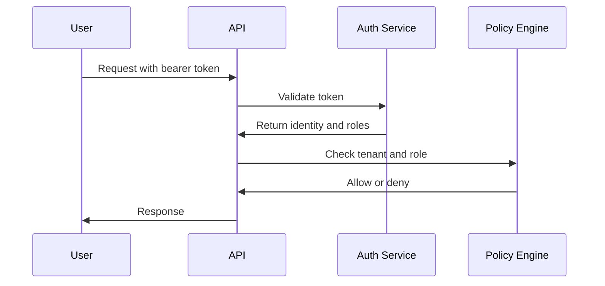

## Overview

Percepteye uses secure access controls so you can protect production systems, separate environments, and grant the right level of access to each team member or service. This starter kit page shows the common patterns you can adapt to your own platform.

You will usually combine three layers:

- A machine credential for service-to-service access
- Role-based access control for human users
- Environment and tenant scoping for safe isolation

<Callout kind="info">
This page is a starter template. Replace the example endpoints, names, and policies with your own implementation details.
</Callout>

## Authentication methods

Use the method that best matches how your client connects to the platform. For backend jobs and internal services, API keys are the simplest option. For interactive users, pair identity with role-based access control. For multi-tenant deployments, always scope the authenticated identity to the correct tenant before you authorize any action.

<Columns cols={3}>
  <Card title="API Keys" icon="key" href="#api-keys">
    Best for server-side requests, scheduled jobs, and automation scripts.
  </Card>
  <Card title="Role-Based Access Control" icon="shield" href="#role-based-access-control">
    Best for assigning permissions to users, groups, and service accounts.
  </Card>
  <Card title="Tenant Scoping" icon="users" href="#environment-and-tenant-permissions">
    Best for isolating data and actions across customers or business units.
  </Card>
</Columns>

## API keys and service credentials

API keys let your services authenticate without a human session. You should generate a separate key for each environment so you can rotate access without affecting unrelated systems.

### Header format

Send the key as a bearer token in the `Authorization` header.

```bash
curl https://api.example.com/v1/agents \
  -H "Authorization: Bearer YOUR_API_KEY" \
  -H "Content-Type: application/json"
```

### Common request pattern

Use a stable base URL, log request IDs, and reject unauthenticated traffic before it reaches your business logic.

<CodeGroup tabs="JavaScript,Python,cURL">
  ```javascript
  const response = await fetch("https://api.example.com/v1/agents", {
    method: "GET",
    headers: {
      Authorization: "Bearer YOUR_API_KEY",
      "Content-Type": "application/json"
    }
  });

  const data = await response.json();
  console.log(data);
  ```

  ```python
  import requests

  response = requests.get(
      "https://api.example.com/v1/agents",
      headers={
          "Authorization": "Bearer YOUR_API_KEY",
          "Content-Type": "application/json",
      },
      timeout=30,
  )

  print(response.json())
  ```

  ```bash
  curl https://api.example.com/v1/agents \
    -H "Authorization: Bearer YOUR_API_KEY" \
    -H "Content-Type: application/json"
  ```
</CodeGroup>

## Role-based access control

Role-based access control, or RBAC, assigns permissions by role instead of by individual user. This makes access easier to audit and reduces the chance of over-permissioning.

### Typical roles

| Role | Typical access |
|------|----------------|
| Owner | Full administrative access, billing, and security settings |
| Admin | Manage users, environments, and configuration |
| Operator | View and update runtime systems |
| Viewer | Read-only access to dashboards and logs |

### Implementation guidance

Assign the minimum role needed for each task. You can start with a small role set and expand it later, but avoid creating too many custom roles too early. Keep permission names explicit so your team can review them quickly.

```json
{
  "user": {
    "id": "usr_8421",
    "email": "ops@example.com",
    "roles": ["admin", "operator"],
    "tenantId": "tenant_northwind",
    "environment": "production"
  }
}
```

## Environment and tenant permissions

You should separate access by environment first, then by tenant. That lets you give developers broad access in development while keeping production tightly controlled.

<Tabs>
  <Tab title="Development" icon="settings">
    
Use this environment for local testing, automated checks, and feature validation. You can allow broader access here, but still keep secrets out of source control.

```bash
export PERCEPTEYE_ENV=development
export PERCEPTEYE_TENANT=tenant_northwind
```

  </Tab>
  <Tab title="Staging" icon="monitor">
    
Use this environment to mirror production behavior with limited access. Only release engineers and QA staff should be able to promote changes.

```bash
export PERCEPTEYE_ENV=staging
export PERCEPTEYE_TENANT=tenant_northwind
```

  </Tab>
  <Tab title="Production" icon="lock">
    
Use this environment for live traffic and sensitive data. Restrict write permissions, require reviewed access, and log every privileged action.

```bash
export PERCEPTEYE_ENV=production
export PERCEPTEYE_TENANT=tenant_northwind
```

  </Tab>
</Tabs>

## Secret management

Never hardcode secrets in application code or commit them to version control. Use your secret manager, deployment platform, or environment injection system to provide credentials at runtime.

<Steps>
  <Step title="Store the secret" icon="database">
    
Save the credential in a managed secret store such as a vault or cloud secret manager.

  </Step>
  <Step title="Inject at runtime" icon="download">
    
Load the secret into the process environment during deploy time, not during build time.

  </Step>
  <Step title="Rotate regularly" icon="refresh-cw">
    
Replace secrets on a schedule and revoke old credentials after the new ones are verified.

  </Step>
</Steps>

### Example environment file

```bash
PERCEPTEYE_API_KEY=YOUR_API_KEY
PERCEPTEYE_TENANT_ID=tenant_northwind
PERCEPTEYE_ROLE=operator
```

## Security best practices

<Callout kind="alert">
Treat every secret as sensitive. Do not print keys in logs, do not embed them in client-side code, and do not reuse the same credential across multiple environments.
</Callout>

Use these practices to keep access predictable and auditable:

- Scope each key to a single application or service.
- Rotate credentials after staff changes or suspected exposure.
- Enforce least privilege for roles, tenants, and environments.
- Log authentication attempts, permission changes, and token refresh events.
- Require approval for production role changes.
- Revoke unused keys promptly.

## Access setup checklist

<Expandable title="Open the production checklist" default-open="false">
  
1. Create a dedicated service credential for each environment.
2. Define roles for owner, admin, operator, and viewer.
3. Map each identity to one tenant or one approved set of tenants.
4. Store all secrets in a secure vault.
5. Verify logs include the authenticated principal and tenant.
6. Test token revocation before launch.

</Expandable>

## Example access flow



## Next steps

Once you have authentication in place, connect it to your deployment workflow, audit logging, and environment controls. If you are building a new integration, start with one service credential, one production role, and one tenant before you expand to more advanced policies.

<Columns cols={2}>
  <Card title="Quickstart" icon="book-open" href="/quickstart" horizontal>
    Set up your first authenticated request and validate access end to end.
  </Card>
  <Card title="Changelog" icon="bar-chart" href="/changelog" horizontal>
    Review recent updates and release notes for your documentation set.
  </Card>
</Columns>