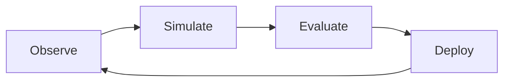

## Overview

PerceptEye is a continuous learning system for production AI teams. It helps you observe real workflows, turn them into testable learning assets, evaluate model changes against success signals, and deploy improvements with confidence.

This page explains the core ideas you will use throughout the docs. It is written as a starter kit, so you can adapt the terms, examples, and architecture to match your own product or deployment model.

<Callout kind="info">

Use this page as the conceptual baseline for your team. If you understand the workflow library, shared source of truth, and evaluation loop, the rest of the documentation becomes much easier to follow.

</Callout>

## Core building blocks

<Columns cols={3}>
  <Card title="Continuous learning loop" icon="refresh-cw" href="#continuous-learning-loop">
    Observe, simulate, evaluate, and improve in a repeatable cycle.
  </Card>
  <Card title="Workflow library" icon="book-open" href="#workflow-library">
    Store testable workflows that represent how your system behaves in practice.
  </Card>
  <Card title="Shared source of truth" icon="database" href="#shared-source-of-truth">
    Keep training data, evaluations, and deployment decisions aligned.
  </Card>
</Columns>

## Continuous learning loop

The continuous learning loop is the system that keeps your AI agents improving after launch. Instead of treating training as a one-time event, you feed real usage patterns back into the learning process.

The loop usually follows four stages:

1. Observe what users and agents are doing.
2. Simulate candidate workflows with controlled inputs.
3. Evaluate outcomes against success signals.
4. Promote improvements into production when they pass your thresholds.

<Steps>
  <Step title="Observe production behavior" icon="eye">
    Capture traces, prompts, decisions, and outcomes from real sessions so you can study how your system behaves in context.
  </Step>
  <Step title="Simulate workflows" icon="play-circle">
    Replay representative tasks in a safe environment to compare model variants, prompt changes, and policy updates.
  </Step>
  <Step title="Evaluate results" icon="check-circle">
    Score each run using business metrics, human review, or automated checks that reflect your quality target.
  </Step>
  <Step title="Deploy improvements" icon="rocket">
    Roll out the best-performing change and continue collecting data for the next iteration.
  </Step>
</Steps>



## Workflow library

A workflow library is a structured catalog of tasks your system can perform. Each workflow should be specific enough to test, but broad enough to represent a meaningful user journey.

You can think of a workflow as a reproducible unit of work. For example, a support triage workflow might include ticket classification, retrieval of relevant knowledge, and response drafting.

### What makes a workflow testable

A testable workflow has clear inputs, expected behavior, and measurable outcomes. You should avoid vague descriptions like "handle support requests" and instead define a concrete scenario such as "classify billing questions and draft an answer using the latest policy."

<CodeGroup tabs="JSON,TypeScript">
  ```json
  {
    "workflowId": "support-triage-billing",
    "name": "Billing triage",
    "input": {
      "subject": "I was charged twice this month",
      "channel": "email",
      "customerTier": "enterprise"
    },
    "expectedOutcome": "Return a policy-compliant response and route urgent cases to support"
  }
  ```

  ```typescript
  type Workflow = {
    workflowId: string;
    name: string;
    input: {
      subject: string;
      channel: "email" | "chat" | "voice";
      customerTier: "standard" | "enterprise";
    };
    expectedOutcome: string;
  };

  const billingWorkflow: Workflow = {
    workflowId: "support-triage-billing",
    name: "Billing triage",
    input: {
      subject: "I was charged twice this month",
      channel: "email",
      customerTier: "enterprise"
    },
    expectedOutcome: "Return a policy-compliant response and route urgent cases to support"
  };
  ```
</CodeGroup>

## Success signals and evaluations

Success signals are the measurable indicators that a workflow finished well. They can come from automated checks, human review, product metrics, or a combination of all three.

Common signals include response accuracy, policy adherence, latency, escalation rate, and user satisfaction. The best signal is the one that matches your actual business goal, not just a generic benchmark.

| Signal | What it measures | Example |
|--------|-------------------|---------|
| Accuracy | Whether the output is correct | The answer matches the approved policy |
| Safety | Whether the output avoids harmful content | No prohibited recommendation appears |
| Latency | How long the system takes | The workflow completes in under `2s` |
| Escalation quality | Whether hard cases are routed correctly | Billing disputes go to a human agent |
| Consistency | Whether repeated runs stay stable | The same input produces the same decision class |

<Callout kind="tip">

Choose a small number of signals first. If you track too many metrics at once, it becomes harder to know which change actually improved the system.

</Callout>

## Shared source of truth

A shared source of truth is the single place where your team keeps the canonical version of workflow definitions, evaluation rules, and deployment records. It reduces confusion by making sure engineering, data, and operations all use the same definitions.

This matters because AI systems change quickly. If one team evaluates against an older prompt version while another team ships a new policy, you can no longer trust the results.

### Recommended contents

- Workflow definitions
- Prompt or policy versions
- Evaluation datasets
- Review labels
- Deployment approvals

## Private cloud and on-prem architecture

PerceptEye can fit into a private cloud or on-prem environment when you need tighter control over data and infrastructure. The same conceptual model still applies: you observe, simulate, evaluate, and deploy inside your own environment.

### When to use each deployment style

<Tabs>
  <Tab title="Private cloud" icon="cloud">
    Use this when you want managed infrastructure with strong tenant isolation and controlled networking.

    Typical benefits include faster setup, centralized updates, and easier scaling for shared internal teams.
  </Tab>
  <Tab title="On-prem" icon="server">
    Use this when data residency, regulated workloads, or existing infrastructure requirements keep your systems inside your own network.

    Typical benefits include local control, custom security boundaries, and compatibility with internal tooling.
  </Tab>
  <Tab title="Hybrid" icon="shuffle">
    Use this when some services stay in your environment while selected components connect to managed services through approved interfaces.

    Typical benefits include gradual migration and flexible security architecture.
  </Tab>
</Tabs>

### Architecture checklist

Before you launch, confirm that you can answer these questions:

- Where does raw workflow data live?
- Who can edit evaluation criteria?
- Which systems are allowed to access model outputs?
- How do you promote a tested change into production?
- How do you audit changes over time?

<Expandable title="Why a shared model matters" default-open="false">

A shared model gives every team the same language for discussing improvements. When your workflow, evaluation, and deployment records all align, you can compare experiments reliably and avoid silent drift.

You should treat the source of truth as an operational dependency, not just documentation. If it falls out of sync, your learning loop becomes harder to trust.

</Expandable>

<Expandable title="What to customize first" default-open="false">

Start by customizing the workflow names, success signals, and deployment rules to match your product. Then adjust the examples and architecture language so it reflects your actual environment, whether that is managed cloud, private cloud, or on-prem.

</Expandable>

## Next steps

Once you understand these concepts, you can move on to setup and implementation with much less friction. If you are customizing this starter kit, replace the generic labels, workflows, and metrics with your real system terms.

<Columns cols={2}>
  <Card title="Quickstart" icon="book-open" href="/quickstart" horizontal>
    Follow the setup guide to create your first workflow and evaluation run.
  </Card>
  <Card title="Authentication" icon="lock" href="/authentication" horizontal>
    Learn how to secure access to your environment and API requests.
  </Card>
</Columns>